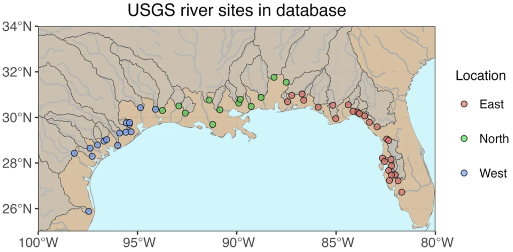

{fig-alt="Map of river monitoring sites from Texas to Florida around the northern Gulf of Mexico, grouped into western sites in blue, northern sites in green, and eastern sites in pink."}

This GRID project output connects river and ocean information for the northern Gulf of Mexico. It includes river chemistry and discharge for 54 rivers, streams, and bayous, together with 17 chemical and physical ocean parameters from the Gulf of Mexico Coastal Ocean Observing System and MODIS and SeaWiFS satellite sensors.

The release distinguishes river observations from daily concentrations and fluxes estimated using the USGS WRTDS model. It provides data with outlier flags and cleaned monthly, seasonal, and annual aggregates. Consult the documentation for the sampling coverage and processing applied to each parameter.

## Access and scope

[Download the dataset on Zenodo](https://doi.org/10.5281/zenodo.10152141).

| Release detail | Information |
|---|---|
| Repository creators | Bailey Armos and Shuang Zhang |
| Dataset release | November 17, 2023 |
| Release DOI | [10.5281/zenodo.10152141](https://doi.org/10.5281/zenodo.10152141) |
| Files | `ROcD-nGoM.zip`, approximately 2.3 GB; includes the river-processing R script |
| Repository license | CC BY 4.0 |

This is a regional product with defined source coverage, rather than an archive of all analyses conducted in the Gulf of Mexico. The repository release predates the associated article.

## Citation and associated article

**Dataset:** Armos, B., and Zhang, S. (2023). *ROcD-nGoM: A River-Ocean Coupled Database for the Northern Gulf of Mexico*. Zenodo. [https://doi.org/10.5281/zenodo.10152141](https://doi.org/10.5281/zenodo.10152141).

**Article:** Armos, B., Zhang, S., Wen, T., Walker, E., and Daripa, P. (2024). *A harmonized river-ocean coupled database for the northern Gulf of Mexico*. Scientific Data. Published December 30, 2024. [Read the data descriptor](https://doi.org/10.1038/s41597-024-04338-1).

[Explore other releases](../data-highlights.qmd) · [Data-use guidance](../data-use-and-embargo-policy.qmd)
