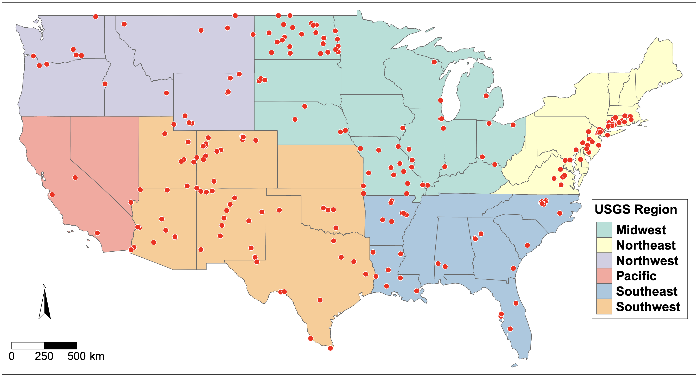

{fig-alt="Map of the coterminous United States with monitoring sites shown as red points and USGS regions shaded in six colors."}

This GRID project output compiles dissolved sodium and alkalinity data with 32 watershed properties for 226 river monitoring sites across the coterminous United States. The accompanying study uses these data to model monthly-aggregated sodium and alkalinity fluxes and examine their relationships with human and natural watershed characteristics.

## Access and scope

[Download data and code on Zenodo](https://doi.org/10.5281/zenodo.7937820).

| Release detail | Information |
|---|---|
| Repository creators | Tao Wen and Beibei E |
| Dataset release | May 15, 2023 |
| Version | 1.0 |
| Release DOI | [10.5281/zenodo.7937820](https://doi.org/10.5281/zenodo.7937820) |
| Files | `Codes_and_Datasets.zip`, approximately 56 MB |
| Repository license | CC BY 4.0 |

The 226-site scope and 32-property feature set describe this study, not the current GRID-wide inventory. Consult the repository files and article for observation coverage, processing choices, and model evaluation.

## Citation and associated article

**Data and code:** Wen, T., and E, B. (2023). *Datasets and codes for the peer review article “Human and natural impacts on the U.S. freshwater salinization and alkalinization: A machine learning approach”* (Version 1.0). Zenodo. [https://doi.org/10.5281/zenodo.7937820](https://doi.org/10.5281/zenodo.7937820).

**Article:** E, B., Zhang, S., Driscoll, C. T., and Wen, T. (2023). *Human and natural impacts on the U.S. freshwater salinization and alkalinization: A machine learning approach*. Science of the Total Environment, 889, 164138. [Read the article](https://doi.org/10.1016/j.scitotenv.2023.164138).

[Explore other releases](../data-highlights.qmd) · [Data-use guidance](../data-use-and-embargo-policy.qmd)
