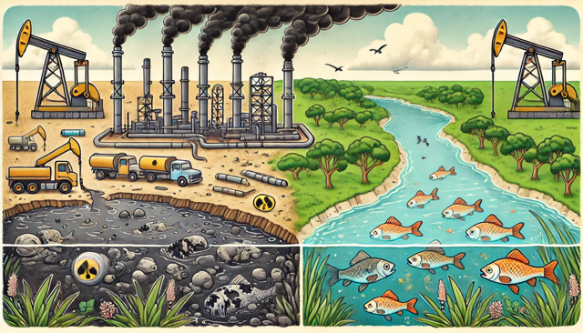

## About the activity

Explore how brine disposal from oil and gas production can affect water quality and how investigators evaluate possible links between disposal and seismic events. Learners compare stream chemistry upstream and downstream of disposal sites in the Allegheny River system and examine disposal practices in Pennsylvania.

- **Audience:** Intermediate undergraduate hydrology students.
- **Estimated time:** 2–3 hours.
- **Tools:** HydroClient, the Pennsylvania DEP Oil and Gas Mapping Tool, and Google Earth.
- **Creator:** Tao Wen.
- **Host:** Science Education Resource Center at Carleton College (SERC).

The activity combines public-data searches, interpretation, and questions for students. It provides teaching materials that can be worked through online.

[Open the activity and instructions on SERC](https://serc.carleton.edu/hydromodules/units/191769.html){.btn .btn-primary}

## Citation

Wen, T. (2017). *Environmental Issues Related to Brine Disposal from Oil and Gas Development in Pennsylvania*. [Teaching activity and citation](https://doi.org/10.67165/cbzks996).

{fig-alt="Conceptual illustration of oil production beside a river, with aquatic life and a cutaway of the ground." width=70%}
