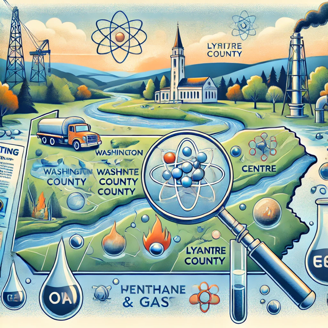

## About the activity

Investigate three hypothetical water-supply complaints involving methane in Pennsylvania surface waters. Students use Shale Network observations and nearby well records to consider multiple possible methane sources. Detecting methane alone does not establish a leaking oil or gas well.

- **Audience:** Intermediate undergraduate hydrology students.
- **Estimated time:** 2 hours.
- **Tools:** HydroClient, the Pennsylvania DEP Oil and Gas Mapping Tool, and EDWIN well records.
- **Creators:** Liza Brazil, Susan L. Brantley, Jennifer Z. Williams, Seth Pelepko, Stew Beattie, Kyle Homman, and Andrew Nyblade.
- **Host:** Science Education Resource Center at Carleton College (SERC).

The cases cover Chartiers Creek, Black Moshannon Lake, and Sugar Run. Instructions guide students through finding observations, examining nearby wells, and considering alternative explanations.

[Open the activity and instructions on SERC](https://serc.carleton.edu/hydromodules/units/143615.html){.btn .btn-primary}

## Source

Brazil, L., and coauthors. [*Using Methane Concentrations in Streams to Investigate for Potential Leakage of Oil and Gas Wells in Pennsylvania*](https://serc.carleton.edu/hydromodules/units/143615.html). See the host page for the original materials and attribution.

{fig-alt="Conceptual illustration combining a stream, oil and gas equipment, sample containers, and a magnifying glass." width=70%}
