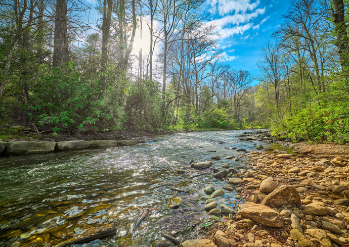

This summary refers to [Dan Bernardi’s Syracuse University article, published June 12, 2023](https://artsandsciences.syracuse.edu/news-all/news-2023/a-machine-learning-approach-to-freshwater-analysis/).

Researchers from Syracuse University and Texas A&M University used observations from 226 U.S. river-monitoring sites and 32 watershed characteristics to model monthly sodium and alkalinity. The work examined how human activity and environmental conditions relate to river chemistry.

Population density and impervious surfaces were important predictors in the sodium model. Climatic and hydrogeological variables were important in the alkalinity model. These predictive associations help frame further investigation; feature importance alone does not demonstrate a causal pathway or quantify net carbon removal.

## Research paper

E, B., Zhang, S., Driscoll, C. T., and Wen, T. (2023). *Human and natural impacts on the U.S. freshwater salinization and alkalinization: A machine learning approach*. **Science of the Total Environment**. [Read the paper](https://doi.org/10.1016/j.scitotenv.2023.164138).

{fig-alt="Mills River flowing over rocks through woodland in Pisgah National Forest, North Carolina."}
