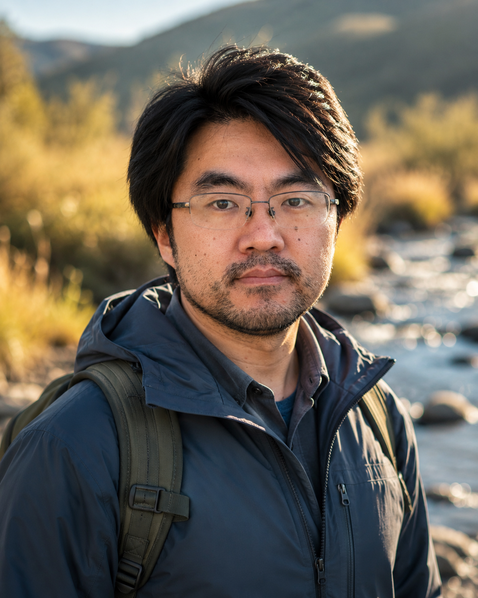
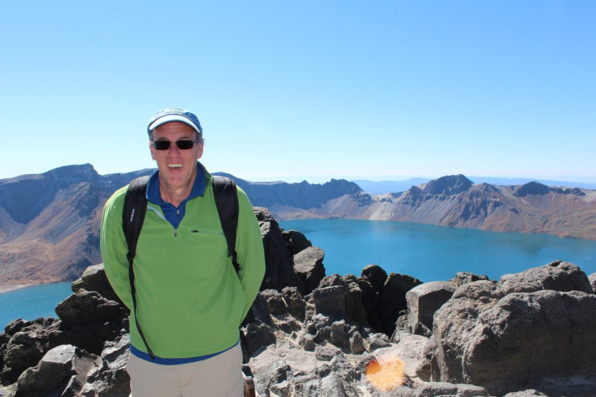
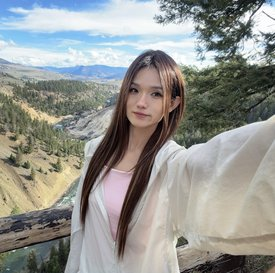
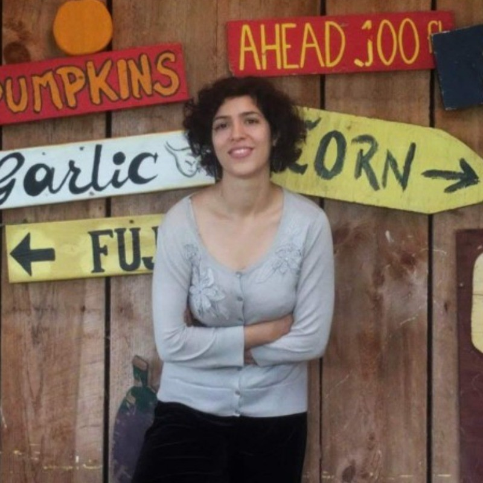
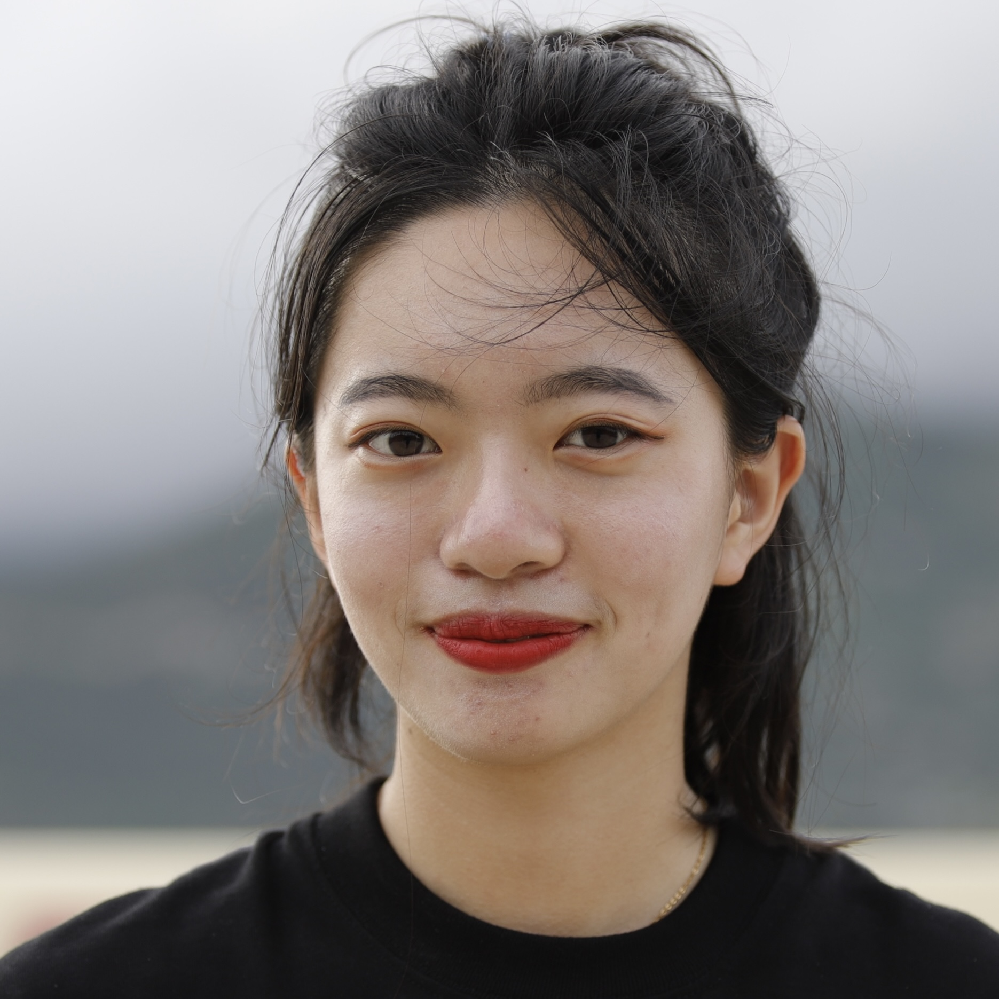

The Global RIver-lanD (GRID) Database began as a collaboration among researchers at Syracuse University, Texas A&M University, and Yale University. Tao Wen and Shuang Zhang continue on the GRID management team. The proposed GRID-SI project brings together a broader team to develop reusable hydrogeochemical datasets and software workflows.

## Core Proposal Team

These researchers form the core team for the proposed GRID-SI project.

```{=html}
<div class="people-grid people-grid-four">
<article class="person-card">
  
  <h3>Tao Wen</h3>
  <p class="person-affiliation">Syracuse University</p>
  <p class="person-expertise">Hydrogeochemistry, carbon–sulfur cycling, and environmental data science.</p>
  <a class="person-link" href="https://jaywen.com/" aria-label="Profile of Tao Wen">Profile</a>
</article>
<article class="person-card">
  
  <h3>Shuang Zhang</h3>
  <p class="person-affiliation">Texas A&amp;M University</p>
  <p class="person-expertise">Carbon-cycle science, weathering, and geochemical modeling.</p>
  <a class="person-link" href="https://artsci.tamu.edu/oceanography/contact/profiles/shuang-zhang.html" aria-label="Profile of Shuang Zhang">Profile</a>
</article>
</div>
```

## Advisory Board for the Proposed GRID-SI Project

The following researchers have agreed to advise the proposed project. Their expertise spans hydrogeochemistry, Earth-surface processes, and scientific data systems.

```{=html}
<div class="people-grid">
<article class="person-card">
  
  <h3>Susan L. Brantley</h3>
  <p class="person-affiliation">Penn State University</p>
  <p class="person-expertise">Critical-zone science, weathering, and water–rock interactions.</p>
  <a class="person-link" href="https://brantley.psu.edu/" aria-label="Profile of Susan L. Brantley">Profile</a>
</article>
<article class="person-card">
  
  <h3>Charles T. Driscoll, Jr.</h3>
  <p class="person-affiliation">Syracuse University</p>
  <p class="person-expertise">Environmental chemistry, ecosystem biogeochemistry, and water-quality modeling.</p>
  <a class="person-link" href="https://ctdrisco.expressions.syr.edu/biographic-information/" aria-label="Profile of Charles T. Driscoll, Jr.">Profile</a>
</article>
<article class="person-card">
  
  <h3>Daniel E. Ibarra</h3>
  <p class="person-affiliation">Brown University</p>
  <p class="person-expertise">River biogeochemistry, coupled water–carbon cycles, and enhanced weathering.</p>
  <a class="person-link" href="https://vivo.brown.edu/display/dibarra" aria-label="Profile of Daniel E. Ibarra">Profile</a>
</article>
<article class="person-card">
  
  <h3>Nicole Fernandez-Franzan</h3>
  <p class="person-affiliation">ETH Zurich</p>
  <p class="person-expertise">Low-temperature geochemistry, water–rock interactions, and carbon storage.</p>
  <a class="person-link" href="https://eaps.ethz.ch/en/people/profile.nicole-fernandez-franzan.html" aria-label="Profile of Nicole Fernandez-Franzan">Profile</a>
</article>
<article class="person-card">
  
  <h3>Andrew Zaffos</h3>
  <p class="person-affiliation">Arizona Geological Survey, University of Arizona</p>
  <p class="person-expertise">Geoscience database architecture, software infrastructure, and large-scale data systems.</p>
  <a class="person-link" href="https://azgs.arizona.edu/person/andrew-zaffos-phd" aria-label="Profile of Andrew Zaffos">Profile</a>
</article>
<article class="person-card">
  
  <h3>Xiaogang (Marshall) Ma</h3>
  <p class="person-affiliation">University of Idaho</p>
  <p class="person-expertise">Semantic interoperability, knowledge graphs, and data provenance.</p>
  <a class="person-link" href="https://www.uidaho.edu/people/max" aria-label="Profile of Xiaogang (Marshall) Ma">Profile</a>
</article>
</div>
```

## Working Group Members

```{=html}
<div class="people-grid people-grid-four">
<article class="person-card">
  
  <h3>Xiumei Ma</h3>
  <p class="person-affiliation">Syracuse University</p>
  <p class="person-expertise">Postdoctoral Scholar</p>
  <a class="person-link" href="https://artsandsciences.syracuse.edu/people/research-associates/xiumei-ma/" aria-label="Profile of Xiumei Ma">Profile</a>
</article>
<article class="person-card">
  
  <h3>Mahnaz Sepehrmanesh</h3>
  <p class="person-affiliation">Syracuse University</p>
  <p class="person-expertise">Postdoctoral Scholar</p>
  <a class="person-link" href="https://www.linkedin.com/in/mahnaz-sepehrmanesh-33b102358/" aria-label="Profile of Mahnaz Sepehrmanesh">Profile</a>
</article>
<article class="person-card">
  
  <h3>Cynthia Sun</h3>
  <p class="person-affiliation">Texas A&amp;M University</p>
  <p class="person-expertise">Graduate Student</p>
</article>
<article class="person-card">
  
  <h3>Zanchenling Wang</h3>
  <p class="person-affiliation">Syracuse University</p>
  <p class="person-expertise">Graduate Student</p>
</article>
</div>
```

## Contact

For questions about GRID or opportunities to contribute, contact [Tao Wen](mailto:twen08@syr.edu).
